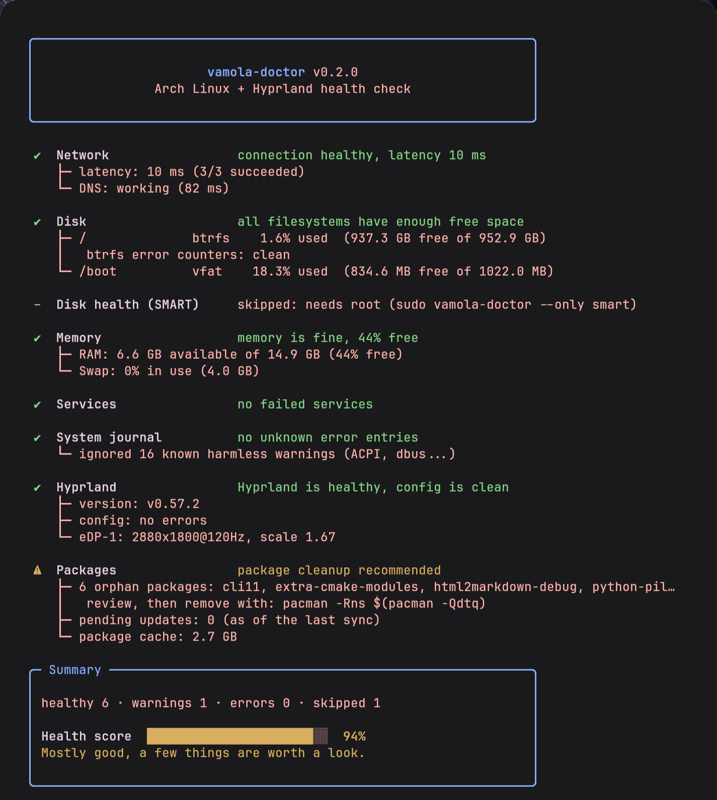

# vamola-doctor

[](https://go.dev)
[](LICENSE)
[](https://archlinux.org)

**A read-only, one-command health check for Arch Linux + Hyprland.**

Right after a fresh install you want to know: *is everything OK?* `vamola-doctor` answers in a
couple of seconds, and it separates harmless log noise (ACPI, dbus...) from real problems.

🇹🇷 [Türkçe README](README.tr.md)



## Install

**Prebuilt binary** (no Go needed), from the [latest release](https://github.com/vam0laa/vamola-doctor/releases/latest):

```bash
curl -L https://github.com/vam0laa/vamola-doctor/releases/latest/download/vamola-doctor-linux-amd64.tar.gz | tar xz vamola-doctor
sudo install -m755 vamola-doctor /usr/local/bin/
```

(`vamola-doctor-linux-arm64.tar.gz` is available for ARM.)

**With Go:**

```bash
go install github.com/vam0laa/vamola-doctor/cmd/vamola-doctor@latest
```

**From source:**

```bash
git clone https://github.com/vam0laa/vamola-doctor
cd vamola-doctor
make build && sudo install -m755 vamola-doctor /usr/local/bin/
```

Optional: `smartmontools` for the SMART module.

## Usage

```bash
vamola-doctor                    # run every check
vamola-doctor --only disk,smart  # only some modules
vamola-doctor --speed            # also run a download speed test (~10 MB)
vamola-doctor --json             # machine-readable output
vamola-doctor --list             # list modules
vamola-doctor --lang tr          # use Turkish for this run
vamola-doctor --choose-lang      # pick the language again and save it
sudo vamola-doctor --only smart  # SMART needs root
```

On the first interactive run it asks for your language (English / Türkçe) and remembers it in
`~/.config/vamola-doctor/lang`. Without a terminal (pipes, cron) it follows your system locale.

**Exit code:** `0` clean · `1` warnings · `2` errors · `64` bad usage — handy for scripts and timers.

## Modules

| Module | What it checks |
|---|---|
| `network` | latency, DNS, (optional) download speed |
| `disk` | filesystem usage (warn 85%, fail 95%), btrfs error counters |
| `smart` | NVMe/SATA SMART status, temperature, wear (needs root) |
| `memory` | RAM and swap |
| `services` | failed systemd units (system + user) |
| `journal` | errors of the current boot; known harmless lines are filtered out |
| `hyprland` | `hyprctl configerrors`, monitor scale (warns on fractional logical resolution) |
| `packages` | orphans, pending updates, cache size, `.pacnew` files |

The **health score** counts a healthy module as 100%, a warning as 60% and an error as 0%;
skipped modules are ignored.

## Safety

- It never changes, deletes or installs anything. Read-only.
- A check that needs root is skipped and reported as such when you don't have it.
- Nothing is uploaded. The only network traffic is the latency probe, a DNS lookup,
  and the optional `--speed` download.

## Adding a module

Write a `func(ctx, Options) Result` in `internal/check/`, add it to `All()` in `check.go`,
add its texts to **both** languages in `internal/i18n/catalog.go` (a test makes sure the two
catalogs stay in sync), and unit-test the parsing logic.

## Roadmap

- [ ] `--fix` for fixable problems, asking before every step
- [ ] AUR package
- [ ] Temperature and fan (`sensors`) module
- [ ] Wi-Fi signal quality

## License

[MIT](LICENSE) © 2026 vam0laa
