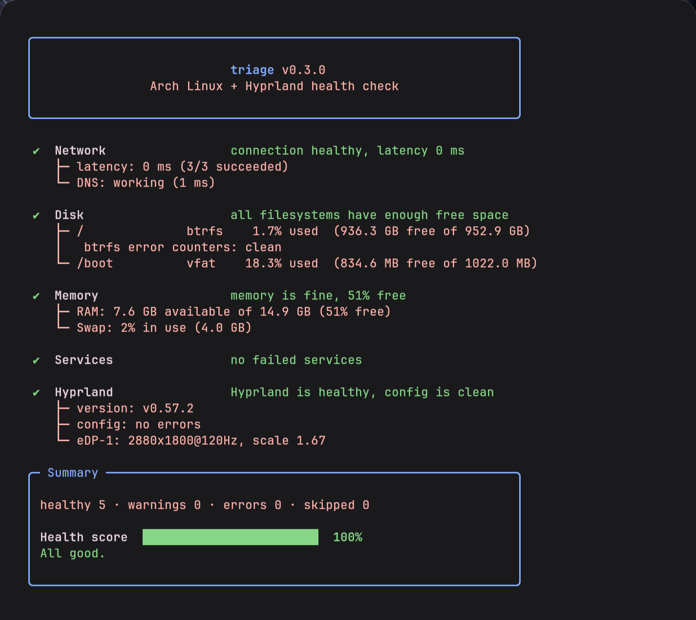

# triage

[](https://go.dev)
[](LICENSE)
[](https://archlinux.org)

**Arch Linux + Hyprland için tek komutluk, salt okunur sistem sağlık kontrolü.**

> `triage`, v0.2.0'a kadar `vamola-doctor` adını taşıyordu. Eski depo adresi buraya yönlenir ve eski adla seçtiğin dil korunur.

Yeni kurduğun sistemde "her şey yolunda mı?" sorusuna saniyeler içinde cevap verir ve
zararsız log gürültüsünü (ACPI, dbus...) gerçek hatalardan ayırır.

🇬🇧 [English README](README.md)



## Kurulum

**Hazır binary** (Go gerekmez), [son sürümden](https://github.com/vam0laa/triage/releases/latest):

```bash
curl -L https://github.com/vam0laa/triage/releases/latest/download/triage-linux-amd64.tar.gz | tar xz triage
sudo install -m755 triage /usr/local/bin/
```

(ARM için `triage-linux-arm64.tar.gz` mevcut.)

**Go ile:**

```bash
go install github.com/vam0laa/triage/cmd/triage@latest
```

**Kaynaktan:**

```bash
git clone https://github.com/vam0laa/triage
cd triage
make build && sudo install -m755 triage /usr/local/bin/
```

İsteğe bağlı: SMART modülü için `smartmontools`.

## Kullanım

```bash
triage                    # tüm kontroller
triage --only disk,smart  # seçili modüller
triage --speed            # indirme hızı testi de yap (~10 MB)
triage --json             # makine okunur çıktı
triage --list             # modülleri listele
triage --lang en          # bu çalıştırmada İngilizce
triage --choose-lang      # dili yeniden seç ve kaydet
sudo triage --only smart  # SMART root ister
```

İlk etkileşimli çalıştırmada dilini (English / Türkçe) sorar ve `~/.config/triage/lang`
dosyasına kaydeder. Terminal yoksa (pipe, cron) sistem diline bakar.

**Çıkış kodu:** `0` temiz · `1` uyarı var · `2` hata var · `64` hatalı kullanım.

## Modüller

| Modül | Ne kontrol eder |
|---|---|
| `network` | gecikme, DNS, (isteğe bağlı) indirme hızı |
| `disk` | bölüm doluluğu (%85 uyarı, %95 hata), btrfs hata sayaçları |
| `smart` | NVMe/SATA SMART durumu, sıcaklık, aşınma (root gerekir) |
| `memory` | RAM ve swap |
| `services` | başarısız systemd servisleri (sistem + kullanıcı) |
| `journal` | bu boot'taki hata kayıtları, bilinen zararsızlar ayrılır |
| `hyprland` | `hyprctl configerrors`, monitör ölçeği (kesirli çözünürlük uyarısı) |
| `packages` | yetim paketler, bekleyen güncelleme, önbellek, `.pacnew` dosyaları |

**Sağlık puanı:** sorunsuz modül %100, uyarı %60, hata %0 sayılır; atlananlar hesaba katılmaz.

## Güvenlik

- Hiçbir şeyi **değiştirmez**, silmez, kurmaz. Sadece okur.
- Root gerektiren kontrol, yetki yoksa atlanır ve "atlandı" diye bildirilir.
- Hiçbir veri gönderilmez. Tek ağ trafiği: gecikme ölçümü, bir DNS sorgusu ve isteğe bağlı `--speed`.

## Yeni modül eklemek

`internal/check/` altına `func(ctx, Options) Result` yaz, `check.go` içindeki `All()` listesine ekle,
metinlerini `internal/i18n/catalog.go` içinde **iki dilde de** ekle (bir test iki kataloğun senkron
kalmasını sağlar) ve ayrıştırma mantığını birim testle doğrula.

## Yol haritası

- [ ] `--fix`: düzeltilebilen sorunlar için, her adımda onay isteyerek
- [ ] AUR paketi
- [ ] Sıcaklık ve fan (`sensors`) modülü
- [ ] Wi-Fi sinyal kalitesi

## Lisans

[MIT](LICENSE) © 2026 vam0laa
